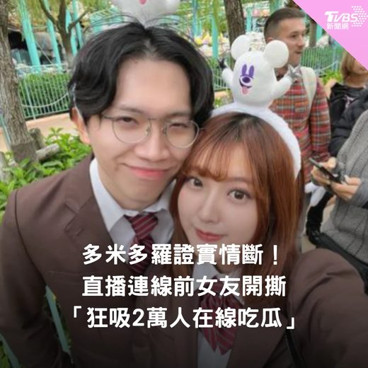

# 圖片套版產生器

單一 HTML 檔案的小工具，貼上標題、上傳圖片（或選純色背景），自動套上 TVBS 娛樂（粉框）／新聞（藍框）版型，輸出 1080×1080 的 PNG 成品。不需安裝、不需建置，開啟 `index.html` 或直接用線上版即可使用。

**線上直接使用（GitHub Pages）：** https://unnn3ing-oss.github.io/QuickPatterntool/

## 介面預覽

| 娛樂版型（粉框） | 純色背景 |
|---|---|
|  |  |

## 功能特色

- **圖片套版（網頁版一律用批次）**：網頁版沒有單張／批次的切換，一開啟就是多組的方式（Chrome 側邊欄仍是單張）。左側最下方「全部清除」在左、「＋ 再做一張」在右，同一列。可一次新增多組圖卡，各自獨立設定類別、標題、字級與背景；支援「全部完成」一次產生、「全部下載」一次匯出，畫布下方會以縮圖顯示已完成的組別供快速切換檢視。
- **背景來源**：圖片背景（點擊選取／拖曳／貼上 Ctrl+V）或純色背景（色票依 HSB 色相排序）；兩種背景會各自記住：先放了圖片、切到純色背景、再切回圖片背景時，原本的圖片（含縮放與位置）和上次選的顏色都會回來，只有「全部清除」才會忘掉；也可以直接把圖片拖到大預覽框，或點一下預覽框後 Ctrl+V 貼上。
- **預覽框直接操作**：滾輪縮放照片、拖曳調整位置（不會露出空白邊）；在預覽圖上點兩下，即可在標題位置的框內直接輸入文字（框只在網頁上顯示，不會輸出到圖片）。
- **字級**：對照 Canva 字級單位。圖片背景（點選、拖曳或貼上）固定為 50，無法調整；純色背景預設 60，可用「－ / ＋」按鈕、在數字上按住滑鼠上下拖曳，或滾動滾輪調整（50～70）。
- **使用說明**：頁面右上角「使用說明」按鈕可開啟功能說明彈窗。
- **從熱門新聞庫送到套版（擴充功能 4.50 以上）**：在熱門新聞庫（`https://unnn3ing-oss.github.io/hottopic/`）的新聞卡片按「送到套版」，新聞網址和卡片**目前顯示的改標**會直接送進側邊欄，並自動執行「快速產圖」：圖上標題用卡片的改標（改標有分行就照卡片的分行；單行的改標才用原本的換行規則），圖片、圖說、hashtag 仍從文章自動抓，完成後停在「直接下載」，不會自動下載。側邊欄沒開時，Chrome 允許就自動打開；不允許就在工具列圖示顯示藍色「1」，點圖示打開側邊欄後自動帶入並產圖（請求只保留 2 分鐘）。只接受 `tvbs.com.tw` 網域的網址。**第一次更新到 4.50 會多一個權限確認（新增只對熱門新聞庫網頁注入的腳本），更新後請把已開著的熱門新聞庫分頁重新整理一次。**

- **切換開關可滑動（網頁版與側邊欄共用）**：「圖片套版／浮水印／拼圖」、新聞／娛樂、圖片背景／純色背景等所有切換開關，選到的白色圓塊會滑順地移到新的那一格；也可以用滑鼠拖曳或手指橫向滑過開關來切換（放開時停在最近的一格，拖到一半放開會彈回去），左右方向鍵也能切換。動畫只用 `transform`（GPU 合成），不會逐格重排版面；`will-change` 只在移動的 0.3 秒才掛上；所有開關共用一個 ResizeObserver、各自只觀察按鈕的 class；系統設定「減少動態效果」時直接到位不做動畫。程式在 `segmented.js`／`segmented.css`，沒有 JS 時退回原本的樣式。
- **浮水印（網頁版）**：頁面上排名稱靠左、中間用「圖片套版／浮水印／拼圖」切換功能。浮水印功能的左上角是照片上傳區（點擊、拖曳或 Ctrl+V 貼上，**可一次放多張，最多 50 張**），多張時預覽下方會出現和「圖片套版」批次相同樣式的展示窗，點縮圖就能預覽、按 ✕ 移除。預設在右上角疊上新版 TVBS NEWS 向量 Logo（大小 13%、邊距 3%、透明度 0%＝完全不透明）；「浮水印圖」可手動切換成舊版「新聞網」PNG Logo（170×100，放大會偏糊）或自己上傳的圖，沒有手動切換就一直是新版，且所有照片共用同一個 Logo。位置只有四個角：**在預覽上直接拖曳 Logo 只改目前這一張**（抓的判定區比 Logo 大，滑鼠移近會出現淡淡的虛線框，放開後吸附到最近的角，縮圖左下角會有藍點標示這張是單獨設定的）；**左側的位置鈕是全部套用**，如果有照片已經單獨調整過，會先跳通知確認再全部改掉。大小、透明度、邊距套用到所有照片。下載維持原圖尺寸（超過 1 億畫素會等比縮小），格式可「沿用原圖」或指定 JPG（品質 95%）／PNG。「下載本張」檔名為「原檔名_浮水印」；「全部下載」檔名為「YYMMDDHHMM_第幾張」（例如 2610122312_1，時間是按下按鈕那一刻取一次，同一批共用，只靠編號分順序），每張之間隔 0.5～1 秒。全程在瀏覽器端完成。
- **拼圖（網頁版）**：上排第三個功能。一張 1080 寬的畫布，把多張照片無縫拼在一起（和 [Line 推播套版產生器](https://unnn3ing-oss.github.io/LinePushPatternTool/) 的拼圖同一套做法，程式是這個專案自己實作的，沒有嵌入或連結到那個網站）。**等分**：直向、橫向各切 1～4 份（相鄰格子共用同一條邊，不會有縫），在預覽上拖曳分隔線調整每格比例，「平均分配」還原。**自由框**：在預覽上拖曳拉出矩形框（最多 12 個）、拖曳移動、拉邊角改大小，靠近畫布邊緣或其他框會自動貼齊；可調整畫布高度（300～5000，做直式長圖）、「＋新增框」接在最下方、「框貼合圖片比例」讓框吻合圖片不裁切（下面的框跟著位移）、上下換位、移到最上／下層、刪除（按 Delete 也可以）；切到「調整照片」才移動框內的照片。每個框一張照片：點擊選擇／拖曳檔案到格子上／選取格子後 Ctrl+V 貼上，一次選多張會依序放進空格；拖曳調整位置、滾輪或滑桿縮放（100～500%）、雙擊換照片。「下載圖片」輸出 1080 寬、300 DPI 的 JPG（品質 95%），檔名 `yyyymmdd拼圖.jpg`；「複製圖片」放進剪貼簿。編輯用的虛線、控制點、選取框只出現在預覽上，不會輸出。
- **尺寸（網頁版）**：上排第四個功能。把照片（可一次放多張，最多 50 張，點擊／拖曳／Ctrl+V）轉成自訂的寬高。**裁切填滿**：寬、高都要填，照片縮放到剛好蓋滿、多的裁掉，在預覽上拖曳可調整保留哪一塊（每張各自記住）；**等比縮放**：寬、高只填一個，另一邊依原圖比例自動算，兩個都填就縮到剛好放進範圍、不裁切。有「⇄」可對調寬高；尺寸上限 10000 像素，比原圖大會提示會偏模糊。輸出格式可「沿用原圖」或指定 JPG（品質 95%）／PNG；縮小幅度大時分段縮（每次最多縮一半），畫質比一次縮到位好。「下載本張」檔名「原檔名_寬x高」；「全部下載」檔名「YYMMDDHHMM_第幾張」。程式在 `resize.js`／`resize.css`，外掛不使用（更新時會略過）。

### 剪輯（網頁版）

上排第五個功能「剪輯」，**只在網頁版**（不會被放進 Chrome 擴充功能）。多軌時間軸：把影片、音訊、圖片排成一支影片，匯出 MP4。版面是左側媒體庫、中間檢視器、右側詳細內容，下方是時間軸。

**外觀與版面**：剪輯分頁預設**深色**（DaVinci 風格的深灰），頁首右上的「深色」開關可切到淺色，選擇會記住，其他分頁一律維持淺色；工具列只有一排，放不下時可左右捲動（滑鼠滾輪也行），復原／重做在最右側；檢視器上方的「直式版面」按鈕可以把預覽放到整頁左側、從頂端延伸到時間軸底部，畫面更大（按鈕一直都在；直式專案預設開啟、橫式預設關閉，兩種各自記住）；上排各欄之間的分隔條可以左右拖曳調整欄寬（一般版面調媒體庫／詳細內容，直式版面調預覽欄／媒體庫），雙擊分隔條恢復預設，寬度會記住；媒體庫可以切換「列表」或「網格」（大縮圖）顯示，選擇會記住；剪輯分頁不顯示右下角的「其他工具」按鈕。

**匯入素材**：在媒體庫匯入影片、音訊或圖片。匯入時會讀取長度與尺寸，並產生縮圖條與波形；大檔不整個讀成 base64，無法讀取的檔案會列出原因。第一支影片的 fps 決定專案的 fps（24／25／30／50／60），之後固定。

**放上時間軸**：在來源檢視器用 I、O 設定入點與出點，再選一種方式放上時間軸（工具列也有對應按鈕，筆電的 F 鍵被系統佔用時可以用按鈕）：

| 方式 | 快捷鍵 | 行為 |
|---|---|---|
| 插入 | F9 | 在編輯點插入，後面的片段往後推 |
| 覆蓋 | F10 | 蓋在編輯點上，不推後面的片段 |
| 替換 | F11 | 以播放頭對齊來源的播放頭，長度與目標片段相同 |
| 加到結尾 | F12 | 接在時間軸最後面 |

時間軸上的入點／出點優先於播放頭。影片有聲音時，影像與聲音會一起放上並自動連結（連結選取開關見下方快捷鍵）。

**工具**（A、B、T 切換，或點工具列）：

- **選取**：選取與移動片段。點時間軸上沒有片段的空白處會取消選取（播放頭不動；要移動播放頭請點時間尺或拖紅色箭頭）。移動到別的片段上時，被蓋到的部分會被覆蓋掉（同 DaVinci）。
- **刀片**：在滑鼠位置切開片段；Ctrl／⌘＋B 則在播放頭切開。
- **修剪**：依滑鼠位置自動變成不同的修剪：
  - 靠近兩段交界的邊緣：**滾動**（兩段一起改，總長不變）。
  - 靠近沒有鄰居的邊緣：**波紋**（改長度，後面未鎖定軌道的片段跟著移動）。
  - 片段中間的上半部：**滑移**（只換來源的位置，長度不變）。
  - 片段中間的下半部：**滑動**（前後鄰居一長一短，這段位置不變）。

**特效與字幕**：左上的「**特效**」分頁（原本叫「轉場」）分成「轉場特效」和「字體特效」兩區。轉場特效有 8 種轉場（交叉疊化、淡出到黑、擦除、推移等）。選好片段後按「**加到開頭**」或「**加到結尾**」，或直接把轉場拖到片段的開頭或結尾。

- 兩段相接的地方是**雙邊轉場**（兩段互相過場）；沒有相鄰片段的開頭是**開頭淡入**，結尾是**結尾淡出**（和背景或黑畫面過場）。
- 轉場附在片段的邊緣上（同 DaVinci）：把相接的兩段拉開時，轉場留在沒被移動的那一段，變成單邊；再接回去會自動變回雙邊。刪除片段只會刪掉附在它上面的轉場。
- 時間軸上的轉場方塊可以點選後在詳細內容調整、拖把手改長度、按 Delete 刪除；方塊只佔片段下半部，上半部的邊緣仍可修剪。
- **轉場時的聲音**：兩段影片都有連結的聲音、而且聲音在同一條音訊軌上相接時，轉場範圍內會自動做等功率的**交叉淡化**（時間軸上會畫出交叉曲線）。來源前後沒有多餘的素材時，淡化會縮短。單邊轉場則讓聲音跟著淡入或淡出。和手動設定的淡入淡出會疊加。

**字體特效**：讓字幕出現時有動畫，有「彈出」「逐行彈出」「逐字彈出」「下往上跳起」「逐行跳起」「逐字跳起」（整塊／一行一行／一個字一個字），選「無」可以移除。選取字幕片段後按「套用到選取的字幕」，或直接把特效拖到時間軸的字幕片段上；長度（預設 0.5 秒）在詳細內容的「動畫」分頁調整。滑鼠移到縮圖上會播放效果。

**字幕**分頁分成三區：
- **字幕清單**：做整支影片的對白字幕。
  - **匯入 SRT**：按「匯入 SRT」或直接把 `.srt` 檔拖進剪輯畫面，每一段會變成「字幕」軌上的一個字幕片段（UTF-8、Big5 都可以）。
  - **V 標記**：在字幕分頁（或選取字幕時），播放控制列右側會出現「**V**」。邊播放邊按 V（或點它），就在播放頭加一段字幕，右側詳細內容的「**清單**」分頁會多一行文字框，可以一行一行輸入（Enter 跳下一行，Shift＋Enter 換行，Esc 離開）。
  - **長度規則**：每段預設 **10 秒**；碰到下一段就提早結束，結束在下一段開始的**前一格**（−1 frame）。在前一段還在播的時候按 V，前一段也會改成在這一格的前一格結束。匯入 SRT 時互相重疊的段落也照這個規則處理。
  - 時間軸上的字幕片段直接顯示字幕內容；點清單裡的時間可以跳到那一段，按 × 刪除。
- **字幕過場**：原本的 6 種動畫預設（靜態、淡入淡出、打字機、下三分之一條、捲動、跑馬燈）。
- **字幕樣式**：一鍵套用外觀（顏色、描邊、外框、陰影、立體、斜體、強調色），不動文字、字型、位置和過場。有「基本」「藍白漸層」「紫色立體」「黑邊青框」「黑邊強調紅」。用法同字體特效（按鈕或拖到字幕片段上）；新增的字幕也會用目前選取的樣式。

**詳細內容分頁**：右側詳細內容依時間軸上點選的物件分成幾個分頁，一次只看一頁，各種物件會記住上次看的分頁：
- 字幕清單的字幕：多一個 **清單** 分頁（所有字幕一行一行列出，放在最前面）。
- 字幕：**文字**（內容、選字變色、字型、字級、位置）｜**外觀**（顏色、描邊、外框、漸層、斜體、立體、陰影、背景）｜**動畫**（字幕過場、字體特效）｜**變形**（含裁切）｜**資訊**
- 影片／圖片：**變形**｜**裁切**｜**音訊**｜**速度**｜**資訊**（沒有的項目不會出現，例如純音訊只有音訊／速度／資訊）
- 轉場、沒選任何東西時不分頁。

**選字變色**：在「文字」分頁，文字會拆成一格一格，點字（或按住拖過一串）就會變成「變色顏色」，再點一次取消；也可以直接在文字裡用 `*星號*` 包住，例如 `進行*瘋狂*的編輯`。

**外框（色框）與文字效果**：在「外觀」分頁可以：
- 按「＋ 增加外框」在描邊外面一圈一圈加色框（最多 4 層，各自調顏色與粗細，可以個別移除）。
- 開「漸層」讓文字上下兩色；調「斜體」角度；調「立體深度／顏色／方向」做立體字。

字幕過場有 6 種動畫預設，字級以短邊 1080 像素為基準，輸出尺寸不同時會等比縮放。字型可選「粗體（預設）」、「仙人掌明體」（Cactus Classical Serif，明體／宋體風格）與「系統黑體」；仙人掌明體是完整字集（約 5.8 萬字，含罕用字），檔案約 10 MB，第一次選用時才下載（之後瀏覽器會快取）。

**在預覽上直接調整素材**：時間軸模式下，點時間軸上的片段（或直接在預覽上點畫面裡的素材，重疊時選最上層），預覽上會出現控制框（字幕是黃色、其他素材是藍色）：拖本體移動位置、拖四個角等比縮放、拖上方圓點旋轉（按住 Shift 每 15° 一格）。拖到畫面中線附近會自動吸附到正中，按住 Alt 不吸附；拖曳中按 Esc 取消。整次拖曳只算一步復原。字幕拖曳改的是字幕的「水平／垂直位置」，其他素材改的是變形的「位置」。

**詳細內容的拉桿**：變形的縮放 X／Y、位置 X／Y，以及字幕的水平／垂直位置都有拉桿，後面保留可以直接輸入數值的框（輸入框可以超出拉桿範圍）；雙擊拉桿恢復預設值。

**安全框**：輸出比例是 9:16 時，檢視器上方會出現「安全框」按鈕。開啟後在預覽上疊一層 Reels／短影音的介面示意（右側愛心、留言、轉發、分享按鈕，下方帳號、說明文字與導覽列；帳號、文字與數字都以灰條代替），會被介面蓋住的範圍顯示成灰色，方便把字幕與重點放在安全範圍內。只在預覽顯示，不會匯出；選擇會記住。

**音訊**：每段音訊可調增益（dB）、左右聲道（Pan）、淡入淡出（可調曲線），以及 6 段 EQ（附頻率響應圖）。軌道可靜音、獨奏、鎖定、隱藏。

**變速、倒播、定格**：Ctrl／⌘＋R 開變速、Shift＋R 開定格對話框、倒播可在速度設定中切換。變速會**同時改變音高**（目前沒有保留音高的選項）。

**輸出比例**：依來源（第一支影片的尺寸，長邊上限 3840）、9:16（1080×1920）、16:9（1920×1080）或 4:5（1080×1350）。

**匯出 MP4**：瀏覽器支援時輸出 H.264＋AAC（一般 Chrome 會走這組）；否則退為 VP9＋Opus。兩者都是 MP4，多數播放器都能播，但後者在某些裝置上的相容性較差。

**多選一起修剪**：先選好多段（Shift／Ctrl 點選或框選），再拖其中一段的邊緣，所有選取的片段會一起加長或縮短同樣的格數。選取工具（A）不推動其他片段（相鄰的片段延長會被擋住）；修剪工具（T）是波紋修剪，後面的片段會跟著推拉、不留空隙。

**快捷鍵**：

| 快捷鍵 | 功能 |
|---|---|
| A／B／T | 選取／刀片／修剪工具 |
| Ctrl／⌘＋B | 在播放頭切開 |
| Delete | 刪除選取的片段（留下空隙） |
| Shift＋Delete／Backspace | 波紋刪除（後面的片段補上空隙） |
| I／O | 設定入點／出點 |
| X | 把選取片段的範圍設為入點／出點 |
| Alt＋X | 清除入點／出點 |
| F9／F10／F11／F12 | 插入／覆蓋／替換／加到結尾 |
| Ctrl＋Shift＋L | 連結選取 開關（關閉時只動點選的那一段） |
| N | 吸附 開關 |
| M | 在播放頭加標記 |
| J／K／L | 倒播／暫停／正播（J、L 連按會加速：1、2、4 倍） |
| 空白鍵 | 播放／暫停 |
| ← → | 前後一格；Shift＋← → 前後一秒 |
| ↑ ↓ | 跳到上一個／下一個剪輯點 |
| Home／End | 跳到開頭／結尾 |
| Ctrl／⌘＋Z | 復原（Ctrl／⌘＋Shift＋Z 或 Ctrl＋Y 重做） |
| Shift＋R | 定格（對話框） |
| Ctrl／⌘＋R | 變速（對話框） |
| Ctrl／⌘＋A | 全選片段 |
| + ／ - | 放大／縮小時間軸 |
| Esc | 取消選取、關閉彈窗 |

**目前限制**：

- 變速會改變音高。
- 很短的片段同時有開頭淡入與結尾淡出、而且兩者範圍重疊時，畫面只會套用其中一個。
- 匯出時整段影片會在記憶體中組好再下載，很長的 4K 影片會吃掉大量記憶體。
- 沒有存檔／讀檔功能，重新整理頁面後專案會消失（匯出前請留意）。
- 桌面瀏覽器專用，手機上不支援。
- 第二階段才會加入：關鍵影格曲線、動態縮放、Speed Ramp（速度漸變）、影像穩定。

## Chrome 擴充功能（側邊欄）

同一份程式也能當 Chrome 擴充功能使用：點工具列圖示，工具會釘在瀏覽器右側的側邊欄，邊看新聞邊套版。

**標題列：** 右上角有「網頁版 ↗」（在新分頁開啟網頁版，浮水印、拼圖等功能在那邊）和「使用說明」兩顆按鈕。

**版面（由上到下）：** 預覽（永遠固定在最上面，下方緊接著新聞／娛樂套版切換，一起固定）→ 快速產圖 → 複製圖文格式 → FB 粉專排程 → 編輯區（字級、背景）→ 版本更新。標題直接在預覽上點兩下修改，輸入游標的位置與畫面上的文字一致（連換行、空行都對得上）。

- **快速產圖**：貼上文章網址按「快速產圖」（或 Enter）。標題帶入預覽，遇到空格、「！」「？」就換行；標題以 3 段為主，「：」只在不足 3 段、或某一行超過 14 個字放不下時才多拆一段；自動抓文章第一張圖當背景（壞掉或太小的圖會往下一張找）。完成後「快速產圖」按鈕會變成「**直接下載**」，並在按鈕上方跳出「確認直接下載？」氣泡：再按一次按鈕或按 Enter 就存成圖片；想先修改就直接改，改好後按「下載圖片」。改了網址、按「下載圖片」或「全部清除」時，按鈕會變回「快速產圖」。沒抓到圖時按鈕不會變，請手動放圖。
- **複製圖文格式**：同時抓好圖說與 hashtag，組成下面這樣的三行文字（文字框可再修改，右上角的「複製內文」按鈕複製的是框內目前內容）：

  ```
  【標題標題標題】
  （圖／王小明攝）
  #標籤一 #標籤二 #標籤三
  ```
  標題不換行、前後加【】；圖說直接取該張照片旁**括號裡的文字**，例如「（圖／王小明攝）」「（示意圖／Shutterstock達志影像）」「（組圖／沈伯洋辦公室提供、柯文哲臉書）」（半形括號會統一成全形）；hashtag 取網頁提供的標籤、最多三個，只留 2～3 個字的標籤（不夠三個就少於三個，不補長的或短的），其中優先挑「無重複文字」的（不和其他標籤互相包含，例如有「沈伯洋」又有「沈伯洋辦公室」就算重複），同一級維持網頁上的原本順序；不夠三個時才用重複的補滿（補的時候也不會選互相包含的兩個）。抓不到的項目會在狀態列說明，複製格式會略過那一行。
- **FB 粉專排程**：到指定時間，外掛自動把貼文發到 Facebook 粉專，並在剛發的貼文下留言。
  1. **粉專**：左邊下拉選單選「新聞粉／娛樂粉／少康粉」（會自動填入網址；選單對應 `tvbsfb`、`tvbsteatimenews`、`2100room`），也可以直接在右邊輸入其他粉專的網址（要是粉專頁面，不是 Facebook 首頁；會記住）。
  2. **內容**：按「帶入目前圖文」會帶入「複製圖文格式」的文字、快速產圖欄的文章網址和預覽上的成品圖；也可以自己打字、按「加入圖片」選圖（PNG／JPG／WebP／GIF，最多 10 張，每張 15MB 內）。
  3. **文章網址＋小編文（自動留言）**：「文章網址」填這則貼文要導流的文章；「小編文」（在發佈時間上面）是留言的第一行。貼文發佈後，外掛會在**剛發的那則貼文**下留言：`小編文`、換行、`文章網址?&utm_source=facebook&utm_medium=追蹤碼`。追蹤碼依粉專與貼文有沒有附圖決定（下方會即時顯示留言預覽）：

     | 粉專 | 有附圖（pic） | 只有文字（comments） |
     |---|---|---|
     | 新聞粉 | `fbarticlepic` | `fbarticlecomments` |
     | 娛樂粉 | `tvbsteatimenewspic` | `tvbsteatimenewscomments` |
     | 少康粉 | `2100roompic` | `2100roomcomments` |

     自訂的粉專不加追蹤碼；文章網址本來就有參數時接在後面（並先拿掉舊的 `utm_source`／`utm_medium`）。小編文與文章網址都留空就不留言。例如：
     ```
     你也這樣覺得嗎？👀
     https://news.tvbs.com.tw/politics/4039103?&utm_source=facebook&utm_medium=tvbsteatimenewscomments
     ```
  4. 選**發佈時間**（至少一分鐘後）按「加入排程」。到時間外掛會自動開一個 Facebook 分頁，點「建立貼文」→ 輸入文字 → 上傳圖片 →（若有「繼續」／「下一步」先按）→ 按「發佈」→ **重新整理頁面**（Facebook 不會即時把新貼文長到目前的頁面上）→ 找到剛發的貼文留言，成功後關掉分頁、回到原本的分頁，並跳出通知。
  5. **條件**：瀏覽器要開著、電腦不能休眠或關機；Facebook 要已登入，且已切換成**粉專身分**（發文框才會是粉專的）。排定時間錯過超過 10 分鐘（例如那時瀏覽器沒開）不會補發，標成「錯過」。一次只跑一筆，同時到點的會間隔 1 分鐘依序發。
  6. **清單**每一筆：等待中／失敗／錯過的可以「**編輯**」（文字、圖片、時間、小編文都能改，改完按「更新排程」，會回到等待中）、「**試跑**」（做完所有動作但不按發佈，分頁停在填好的畫面）、「**立即發佈**」（要先確認）、「刪除」。已發佈的可以「**試跑留言**」（把留言打好但不送出）和「**補留言**」。失敗會顯示卡在哪一步並保留分頁；狀態寫著「貼文可能已經發出」時請先到粉專確認，免得重複發文。**貼文發佈了但留言失敗**會標成「已發佈」並用紅字寫留言失敗的原因，分頁會留著，可以按「補留言」或手動留言。
  7. **卡住了怎麼辦**：執行中的排程會顯示「已執行多久」，並有「**中止**」按鈕（側邊欄與網頁版都有）。內容腳本每 4 秒回報一次心跳，頁面被重新載入、分頁當機時，失聯超過 45 秒就會自動收尾（留言階段會自動接手再做一次）；整次執行最多 5 分鐘。中止時如果已經按下發佈，請先到粉專確認貼文有沒有發出，再決定要不要重發。
  8. **第一次使用請先試跑**（也請試一次「試跑留言」：用已發佈的貼文）。Facebook 的介面常改版，這個功能是靠畫面上的文字與角色找按鈕，改版後可能失效（失效時會明確報錯，不會亂發；留言會先確認找到的是剛發的那則，找不到就不留言，並在錯誤訊息裡回報頁面實際的結構，方便調整）。
  > 自動操作 Facebook 介面不是官方提供的方式，有被 Facebook 判定為自動化行為的風險；建議低頻使用。粉專本身也有 Facebook 官方的排程功能，不需要瀏覽器開著，兩者可以並用。
- **網頁版的「快速產圖」**：網頁版左邊編輯區每張圖片卡片上，「下載／完成」和「新聞／娛樂」之間有一個小輸入框：貼上文章網址、按 **Enter**，標題（和側邊欄同一套斷行規則）與首圖就帶進這張卡片（圖說、hashtag 會記起來，給排程抽屜的「帶入目前圖文」用）。**需要已安裝並更新外掛**：網頁自己抓別家網站會被瀏覽器的跨網域限制擋住，所以由外掛代為下載；為了安全，外掛只代抓 `https://….tvbs.com.tw` 的文章（圖片限公開網站、而且必須真的是圖片）。沒裝外掛時輸入框會顯示說明。用過快速產圖的卡片，完成後在排程抽屜按「帶入目前圖文」，會連文章網址與圖文格式（【標題】／圖說／hashtag）一起帶入，並自動帶好追蹤碼。
- **網頁版的「排程」抽屜**：網頁版（GitHub Pages）在「**圖片套版**」分頁的右邊緣有一個「排程」頁籤（切到浮水印、拼圖、尺寸、剪輯時不顯示），點一下就從右側彈出同一份排程清單與表單（新增、編輯、試跑、立即發佈、補留言都能做），頁籤上的紅色數字是等待中的筆數。排程資料存在外掛裡，所以要**已安裝並更新外掛**；沒裝的話抽屜會顯示說明。網頁版的「帶入目前圖文」取**左邊正在編輯（展開）的那張卡片**：只要有標題和背景就能帶入，不用先按「完成」（成品圖與按「完成」渲染的一樣）；有多張卡片時以展開的那張為準，沒有展開的就退回最後完成的。標題放進【】，用過快速產圖的卡片另外帶入圖說、hashtag 與文章網址。
- **複製圖片**：編輯區的「複製圖片」會把成品圖（1080×1080 PNG）直接放進剪貼簿，可以不下載就貼到其他地方；一樣有標題和背景才能按。
- **標題同步**：在預覽上改標題時，「複製圖文格式」的第一行【標題】會即時跟著改（圖說、hashtag 不動；標題清空就拿掉第一行）。
- **開啟時的更新彈窗**：每次打開側邊欄都會自動檢查更新；有新版時會跳出視窗蓋住整個側邊欄，顯示版本變化（例如 v4.00 → v4.10）與更新說明，按「立即更新」就更新、「稍後再說」（或 Esc）先關掉，下次打開再提醒。
- **版本說明**：更新彈窗與「版本更新」卡片會顯示這次更新的「新增功能或版本更動簡述」（來自 `changelog.json`）。
- **版本更新**：「檢查更新」會和 GitHub 上 `main` 的最新檔案比對；有新版時按「更新到最新版」，只下載有差異的檔案並自動重新載入。第一次更新需選擇擴充功能所在的資料夾（之後會記住）。背景每小時自動檢查一次，有新版時工具列圖示會出現紅色「新」。為了不用盡 GitHub 的查詢次數，會記住上次的結果（`storage` 權限就是用在這裡），沒有新 commit 時每次只花 1 次 API 請求。畫面會顯示版本號（目前 v1.30 → 最新 v1.40，取自 GitHub 上最新版 `manifest.json` 的 `version`）；更新前會列出要更新的檔案（標示新增／修改）；如果新版的 `manifest.json` 增加了權限、內容腳本或 CSP 等設定，會先跳出確認視窗，取消就不會寫入任何檔案；`manifest.json` 一律最後才寫入。

**安裝（最快）：** 在網頁版右上角按「安裝插件」，會開啟**全螢幕的安裝教學**（跟「YouTube 批量下載器」的安裝步驟同一種風格）：每一步都有動畫示意圖，畫出實際在 Chrome 會看到的畫面（分頁列、網址列、擴充功能頁、選資料夾視窗、側邊欄…），右邊是對應的操作步驟；需要輸入的文字都做成「複製」按鈕，不用自己打。共 6 步：
1. **建立資料夾**：顯示建議的資料夾名稱 `QuickPatterntool`，按「複製名稱」貼到選取視窗的「新增資料夾」。
2. **下載檔案**：按「選擇資料夾並寫入」，網頁會把 GitHub 最新版的擴充功能檔案寫進去（Chrome 問「要讓這個網站編輯檔案嗎」請按「編輯檔案」）；也可以按「改下載 ZIP」，解壓縮後使用。
3. **開啟擴充頁**：按「複製網址」，在 Chrome 開新分頁（Windows `Ctrl+T`／Mac `⌘T`）貼上 `chrome://extensions` 並按 Enter；按鍵會依你的電腦顯示 `Ctrl` 或 `⌘`。
4. **開發人員模式**：打開擴充功能頁右上角的「開發人員模式」。
5. **載入插件**：按「載入未封裝項目」→ 選步驟 2 的資料夾（畫面會顯示資料夾名稱；選到上一層會出現「找不到 manifest」，教學裡有說明要再點進去一層）。
6. **開始使用**：按網址列右邊的拼圖圖示，把「圖片套版產生器」釘選到工具列，點一下圖示即可開啟側邊欄。

操作方式：按底下的「上一步／下一步」，或點上方進度列的圓點、按方向鍵 ← →；`Esc` 或右上角 ✕ 關閉；開著時背景網頁不能捲動，Tab 鍵也只會在教學畫面裡移動。動畫是一次性的，播完停一下會自動重播；作業系統設定「減少動態效果」時不播放，圖停在「做完」的樣子。

> 網頁沒辦法直接替瀏覽器安裝擴充功能，所以步驟 3～6 一定要在 Chrome 裡手動做一次。瀏覽器的「選資料夾」視窗沒有辦法預先填好資料夾名稱，所以才提供複製按鈕；寫入時，選到空資料夾或本來就是這個擴充功能的資料夾會直接寫在裡面，選到有其他東西的資料夾則會在裡面建立（或沿用）`QuickPatterntool` 子資料夾，只新增、不動你其他檔案；如果裡面已有同名但不是這個擴充功能的非空資料夾，就會拒絕。

**安裝（手動）：** 下載或 clone 這個 repo（資料夾裡要有 `manifest.json`），再照上面步驟 3～5 載入。

> 擴充功能需要讀取文章網頁與圖片，因此要求「存取所有網站」權限（`host_permissions`）；它只在你按下「快速產圖」或「檢查更新」時連線。
>
> 快速產圖的網路防護：文章在公開網站時，裡面的圖片網址如果指向內網或本機（192.168.x.x、localhost 等，常見於路由器、NVR）會直接略過；文章與圖片分別有 15／20 秒逾時、5MB／20MB 大小上限，最多試前 6 張圖；改貼別的網址或按「全部清除」會立刻中止上一次的下載。圖片被轉址到內網時無法事前攔截，只能不採用。

## 使用方式

1. 開啟頁面（線上版或本地 `index.html`）。
2. 在上排確認是「圖片套版」（另外兩個是「浮水印」「拼圖」）。
3. 選類別（新聞藍框／娛樂粉框）、輸入標題、選擇背景。
4. 純色背景需要的話可微調字級（圖片背景固定 50）。
5. 每組按「完成」或「下載」（或「全部完成」＋「全部下載」）取得 PNG 檔。

## 檔案結構

| 檔案 | 說明 |
|---|---|
| `index.html` | 網頁版頁面（結構），樣式與程式在下面兩個共用檔 |
| `style.css` / `app.js` | 套版全部功能（Canvas 繪圖），網頁版與擴充功能共用，純 CSS + 原生 JavaScript，無外部相依套件 |
| `manifest.json` / `background.js` | Chrome 擴充功能（Manifest V3）設定；點圖示開側邊欄、定時檢查更新 |
| `sidepanel.html` / `sidepanel.css` / `sidepanel.js` | 側邊欄頁面與版本更新區塊 |
| `bridge.js` | 熱門新聞庫的橋接：內容腳本（只注入熱門新聞庫頁面）接收卡片的「送到套版」，background 與側邊欄共用的驗證函式（網址、標題、sender、暫存時效） |
| `scheduler.js` / `poster.js` / `fbpost.js` / `schedbridge.js` / `schedui.js` / `sched.css` / `schedpanel.js` | FB 粉專排程：`scheduler.js` 佇列資料格式、驗證、粉專預設與追蹤碼、留言組合（側邊欄、網頁版、背景、測試共用）；`poster.js` 背景到點執行（鬧鐘、開分頁、狀態流轉、通知）與網頁版 API；`fbpost.js` 內容腳本（只注入 facebook.com，實際操作發文框與留言）；`schedbridge.js` 內容腳本（只注入網頁版頁面，網頁版和外掛之間的橋接：排程讀寫、快速產圖代抓）；`schedui.js` / `sched.css` 排程介面（側邊欄與網頁版抽屜共用）；`schedpanel.js` 側邊欄接資料 |
| `schedweb.js` / `schedweb.css` | 網頁版專用：右側「排程」隱藏式抽屜（透過 `schedbridge.js` 讀寫外掛裡的排程；不會被放進擴充功能）；也提供網頁和外掛之間的橋接用戶端 `QptWebBridge` |
| `qfweb.js` / `qfweb.css` | 網頁版專用：左邊編輯區每張卡片的「快速產圖」小輸入框（按 Enter；文章與圖片請外掛代抓，解析用 `quickfill.js`；不會被放進擴充功能） |
| `quickfill.js` | 快速產圖：抓文章標題／首圖／圖說／hashtag、標題換行規則、複製圖文格式。三種載入方式：側邊欄（完整介面）、網頁版（只用解析與格式的純函式）、背景（只用下載函式，替網頁版代抓） |
| `updater.js` | 從 GitHub 比對並下載最新版檔案 |
| `segmented.js` / `segmented.css` | 切換開關的滑動動畫與拖曳切換（網頁版與側邊欄共用，會被放進擴充功能） |
| `watermark.js` / `watermark.css` | 網頁版專用：上排名稱＋「圖片套版／浮水印／拼圖」功能切換，以及「浮水印」功能本身（不會被放進擴充功能） |
| `collage.js` / `collage.css` | 網頁版專用：「拼圖」功能本身（獨立的檔案；不會被放進擴充功能） |
| `deploy.js` / `deploy.css` | 網頁版專用：「安裝插件」全螢幕教學（6 步驟動畫示意＋複製按鈕；抓 GitHub 最新版檔案寫入資料夾或打包 ZIP），以及右下角圓形「N」按鈕的「其他工具」彈窗（進入網頁時會自動打開、5 秒後自動收起；5 秒內碰到它就不再自動收），介紹並連到 [Line 推播套版產生器](https://unnn3ing-oss.github.io/LinePushPatternTool/) 與 [YouTube 批量下載器](https://unnn3ing-oss.github.io/videodownload/)（不會被放進擴充功能） |
| `test/` | 單元測試（`node --test test/*.test.js`）與瀏覽器流程測試（`NODE_PATH=<有 playwright 的 node_modules> node --test test/sidepanel.e2e.js test/schedpanel.e2e.js test/schedweb.e2e.js test/qfweb.e2e.js test/fbpost.e2e.js`；`sidepanel`／`schedpanel` 用假的 `chrome.*`，`schedweb`／`qfweb` 在假的網址載入網頁版並放進真的橋接與背景程式（共用 `test/web-harness.js`），`fbpost` 用模擬的 Facebook 發文框、動態牆與留言框）；不會被放進擴充功能 |
| `icons/` | 擴充功能圖示（16／32／48／128） |
| `whz-heavy.ttf` | 套版標題與網頁大標題使用的字型（WHZ-Heavy），以 `@font-face` 載入；其餘介面文字使用系統內建中文字型（蘋方／微軟正黑體） |
| `examples/` | 使用說明彈窗與本文件的介面預覽圖 |
| `favicon.svg` / `favicon-*.png` / `favicon.ico` / `apple-touch-icon.png` | 網站圖示，涵蓋現代瀏覽器（SVG）與舊瀏覽器／iOS 加入主畫面的相容尺寸 |

## 技術說明

- 純前端實作，圖片合成、文字排版、角標／Logo 疊圖皆透過 Canvas 2D API 即時繪製。
- 無框架、無建置流程，任何現代瀏覽器直接開啟 `index.html` 即可執行。
- 下載功能使用 `canvas.toBlob('image/png')` 產生檔案，並在位元組層級手動插入 PNG 的 `pHYs` 中繼資料區塊（不經過 base64，速度比舊作法快數倍），將輸出標記為 300 DPI（像素尺寸仍是 1080×1080，只是附上印刷/設計軟體會讀取的解析度資訊），全程在瀏覽器端完成，不會上傳任何圖片或標題內容到伺服器。網頁版 `index.html` 設有內容安全政策（CSP）：只允許載入本站腳本，網路連線只開 `api.github.com` 與 `raw.githubusercontent.com`（「安裝插件」用），沒有任何第三方資源。

## 本地開發

直接用瀏覽器開啟 `index.html` 即可，修改後重新整理頁面查看結果，不需額外安裝依賴或啟動伺服器。

## 授權與使用範圍

本專案未附開源授權條款，僅供個人／內部工作流程使用。套版中的角標與版型樣式對應 TVBS 娛樂／新聞識別，請勿另作商業散布或移轉用途。

## 版本編號規則

版本號寫在 `manifest.json` 的 `version`，格式 `主版本.兩位數`（例如 `1.24`、`2.00`），畫面和 Chrome 擴充功能管理頁都會顯示。**每次推送到 `main` 前都要依下表更新，並在 `changelog.json` 補上這個版本的簡述**（見下方）。

| 這次改了什麼 | 怎麼遞增 | 例子 |
|---|---|---|
| 更改功能或介面（大改版、新增主要功能） | 主版本 +1，後兩位歸零 | `1.24` → `2.00` |
| 部分小功能修正 | 十位數 +1，個位數歸零 | `1.24` → `1.30` |
| 介面完善、小 BUG 修復 | 個位數 +1 | `1.24` → `1.25` |

**版本說明（`changelog.json`）**：每個版本一筆，格式 `"4.20": { "summary": "一行簡述", "items": ["新增功能或更動的條列", …] }`，用繁體中文寫「新增了什麼／改了什麼」。有新版時，更新彈窗和「版本更新」卡片只顯示**最新版**那一筆（跨好幾個版本更新時，不列出中間的版本）；最新版沒有說明時，退回本機版本之後最新的一筆，都沒有才顯示 GitHub 的提交訊息。簡述最多 80 字、條列最多 12 條、每條最多 140 字；內容只當純文字顯示，並用 git blob SHA 驗證沒被竄改。

- **只改網頁版、沒動到外掛的推送，不升版號、不改 `manifest.json` 和 `changelog.json`**，外掛才不會跳出更新通知。外掛的更新通知只看「外掛會用到的檔案」有沒有差異；網頁版專用的檔案（`index.html`、`deploy.js/css`、`watermark.js/css`、`collage.js/css`、圖示、`README.md` 等，見 `updater.js` 的 `SKIP`，新增網頁版專用檔案時 `updater.js` 和 `deploy.js` 的 `SKIP` 都要加；注意：新檔案對「還沒更新過 `SKIP`」的舊版外掛來說仍是新增的檔案，所以新增網頁版專用檔案的那一次推送，外掛會跳一次通知，要升版並說明）改了不算。推送前用 `git diff --stat origin/main` 檢查：只要有動到 `app.js`、`style.css`、`segmented.*`、`sidepanel.*`、`quickfill.js`、`updater.js`、`background.js`、`manifest.json`、`changelog.json` 其中任何一個，就是外掛也有變動，才依上表升版並補說明。
- 數字照一般進位（`1.29` 再 +1 是 `1.30`）。
- 同一次推送混合了不同類型時，取最大的那一種。
- 備份分支用的是修改前的版本號，例如 `backup/v1.23-…`。
- 版本號含 `00`、`05` 這種前導零：實測 Chromium 可以載入；若將來上架 Chrome 線上應用程式商店，官方文件規定整數不可有前導零，屆時要改成 `2.0`、`1.5` 這種寫法。
